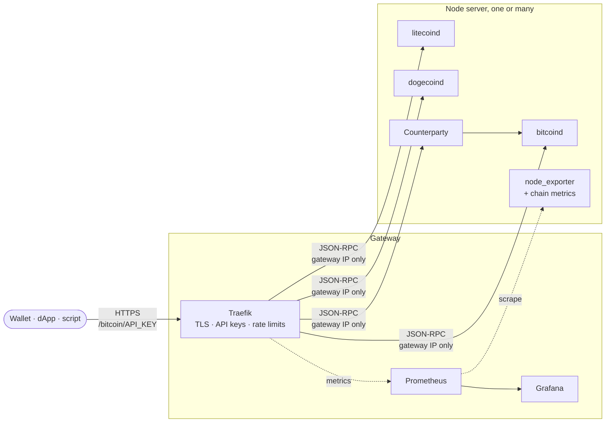

<div align="center">

# RPC-automation

### Your own blockchain RPC nodes. One `.env`, one command.

Bitcoin · Litecoin · Dogecoin · Counterparty, on your own servers, behind HTTPS and API keys,<br>
with Prometheus and Grafana, deployed by Ansible into lightweight [sdme](https://github.com/fiorix/sdme) containers.

[](LICENSE)


<sub>A real run against a fresh Ubuntu 24.04 server, sped up. Nothing is mocked.</sub>

</div>

---

## Why

Every wallet, explorer and dApp talks to a blockchain through an RPC endpoint.
Most people rent one, which means trusting someone else's node, their uptime,
their rate limits and their logs.

If you have a capable server, you can run your own. This repo makes that a
five-minute job instead of a weekend: fill in a `.env`, run one command, and
you get production-shaped endpoints you control end to end.

- **Free and open.** MIT-licensed. No account, no license key, no telemetry.
- **Auditable.** About 1,000 lines of Ansible, templates and Python you can
  read in an afternoon. Every image is pinned to a version.
- **Yours.** Your hardware, your keys, your logs (there are none: request paths
  carry API keys, so access logging is off by design).

## What you get

| | |
|---|---|
| 🔗 **Endpoints** | `https://your-domain/<chain>/<api-key>`, JSON-RPC for the coins, REST for Counterparty |
| 🔐 **Gateway** | Traefik with Let's Encrypt, API keys, per-IP rate limits, request size limits |
| 🧱 **Isolation** | Each chain runs in its own systemd-nspawn container via sdme, with data on the host |
| 🛡️ **Firewall** | ufw: deny by default; SSH, P2P and 80/443 open; node RPC reachable from the gateway only |
| 📈 **Monitoring** | Prometheus + Grafana with a ready dashboard: block height, sync progress, peers, requests, CPU, RAM, disk |
| 🔁 **Day 2** | Re-run to change anything. Only what changed is replaced, chain data stays put |

## Hardware

Run as many chains as your box can hold. Approximate figures for October 2026;
chains grow every day, so leave headroom.

| Chain | Pruned (`PRUNE_MB=5120`) | Full node (`PRUNE_MB=0`) | RAM | Images |
|---|---|---|---|---|
| Bitcoin | ~15 GB | ~800 GB SSD | 4 GB+ | amd64, arm64 |
| Litecoin | ~10 GB | ~200 GB SSD | 2 GB+ | amd64, arm64 |
| Dogecoin | ~10 GB | ~200 GB SSD | 4 GB+ | amd64 |
| Counterparty | needs full Bitcoin | ~900 GB SSD total with Bitcoin | 8 GB+ | amd64 |

A single 4-core / 16 GB VPS with a 1 TB NVMe disk runs all four. Pruned nodes
serve current state and new blocks, not historical blocks; choose full nodes if
you need `getblock` for old heights or `txindex` lookups.

## Quick start

You need: one or more fresh **Ubuntu 24.04** (or Debian 12) servers with SSH
access, and **Ansible** on your computer (`pipx install ansible-core`).

```sh
git clone https://github.com/criptografia-app/RPC-automation && cd RPC-automation
./deploy.sh init      # creates .env with random passwords and an API key
$EDITOR .env          # server IPs, SSH user/key, domain, chains
./deploy.sh           # deploys everything
./deploy.sh test      # calls every chain through your gateway
```

Before deploying with a real certificate, point an `A` record for `RPC_DOMAIN`
at the gateway's IP. To try it without a domain, set `TLS_MODE=selfsigned`.

Then:

```sh
curl -s https://rpc.example.com/bitcoin/$API_KEY \
  -d '{"jsonrpc":"1.0","id":1,"method":"getblockchaininfo","params":[]}'
```

Grafana is at `https://rpc.example.com/grafana/` (user `admin`).

## Everything lives in `.env`

[`.env.example`](.env.example) is the whole configuration, commented. The
Ansible inventory is generated from it by [`inventory.py`](inventory.py), so
there are no inventory files or YAML to edit.

| Setting | What it does |
|---|---|
| `NODE_HOSTS` | Your servers, comma-separated. Each runs every chain in `CHAINS`; the gateway load-balances across them |
| `EDGE_HOST` | A separate gateway server. Empty means the first node is the gateway (single-server setup) |
| `NODE_PRIVATE_IPS` / `EDGE_PRIVATE_IP` | Private or VPN IPs, so gateway-to-node traffic stays off the public internet |
| `SSH_USER`, `SSH_KEY`, `SSH_PORT` | How Ansible reaches the servers (`SSH_PASSWORD`/`SUDO_PASSWORD` if you must) |
| `CHAINS` | `bitcoin,litecoin,dogecoin,counterparty`, any subset |
| `PRUNE_MB` | Block storage per chain; `0` for full nodes |
| `RPC_DOMAIN`, `ACME_EMAIL`, `TLS_MODE` | HTTPS via Let's Encrypt, or self-signed for testing |
| `CLOUDFLARE_DNS_API_TOKEN` | Optional DNS challenge instead of port 80 |
| `API_KEYS` | Comma-separated client keys; add or remove, re-run, no restart needed |
| `FIREWALL`, `FORCE_IPV4` | Host hardening and IPv6 workarounds |

`./deploy.sh` validates the file before touching any server and tells you
exactly what to fix.

## How it works



1. **`inventory.py`** turns `.env` into an Ansible inventory: one host per
   node, a gateway (separate or co-located), and every setting as a variable.
2. **`common`** installs sdme, imports an Ubuntu base image, turns on the
   firewall (SSH first, so you can't lock yourself out) and installs node_exporter.
3. **`nodes`** renders a Kubernetes-style Pod manifest per chain and runs it
   with sdme as a systemd-nspawn container. RPC binds to loopback, plus the
   private IP only when the gateway lives elsewhere.
4. **`edge`** runs Traefik, Prometheus and Grafana the same way. API keys are
   matched in the route, stripped from the path, and never reach a node.

Run it again any time. Pods are only recreated when their manifest changes,
and chain data lives in `/var/lib/rpc-automation` on the host, so it survives
upgrades.

## Day 2

| I want to… | Do this |
|---|---|
| Add a chain | Add it to `CHAINS`, run `./deploy.sh` |
| Add a server | Append it to `NODE_HOSTS`, run `./deploy.sh` |
| Add or revoke an API key | Edit `API_KEYS`, run `./deploy.sh --tags edge` (live, no restart) |
| Upgrade a node | Change its image tag in [`group_vars/all/main.yml`](group_vars/all/main.yml), run `./deploy.sh` |
| Preview changes | `./deploy.sh check` |
| See my URLs | `./deploy.sh endpoints` |
| Check health | `./deploy.sh test`, or the Grafana dashboard |

## Tested

Every release is deployed for real, not just syntax-checked:

| Setup | Result |
|---|---|
| Single server (node + gateway), Ubuntu 24.04, Bitcoin + Litecoin | deploys, `./deploy.sh test` passes, second run changes nothing |
| Two servers (node + separate gateway over a private network) | deploys, gateway reaches the node over the private IP, node RPC unreachable from anywhere else |
| Wrong API key | 404, never reaches a node |
| Grafana | dashboard provisioned, metrics from every server |

Those runs were on arm64 VMs. The Dogecoin and Counterparty images are
amd64-only, so they run on typical x86 servers but weren't part of that run.
Found a problem? Issues and PRs are welcome.

## Security model

- The only public ports are SSH, P2P and 80/443. Node RPC listens on loopback,
  or on the private IP with the firewall allowing only the gateway.
- Clients never get node credentials. The gateway adds them after the API key
  matches.
- Secrets stay in `.env` (git-ignored, `chmod 600`) and in root-only files on
  the servers.
- SSH host keys are trusted on first use and refused if they change.
- No telemetry: Grafana analytics are off, and nothing phones home.

Read the code before you trust it with production traffic. That's the point.

## Want it run for you?

**CRIPTOGRAFIA** builds and operates this stack professionally: sizing and
buying hardware, deployment, monitoring and alerting, upgrades, more chains,
and wallet-based access with usage tiers. On your hardware or ours.

📬 **marco@criptografia.app**

Either way, the code stays open. Running your own node should be normal, not a
luxury.

## Credits

Built on excellent open source: [sdme](https://github.com/fiorix/sdme) (systemd
containers), [btcpayserver/dockerfile-deps](https://github.com/btcpayserver/dockerfile-deps)
(Bitcoin, Litecoin and Dogecoin images), [Counterparty](https://github.com/CounterpartyXCP/counterparty-core),
[Traefik](https://traefik.io), [Prometheus](https://prometheus.io) and
[Grafana](https://grafana.com).

## License

[MIT](LICENSE). Provided as is, without warranty. You're responsible for the
servers you run and the endpoints you expose.
